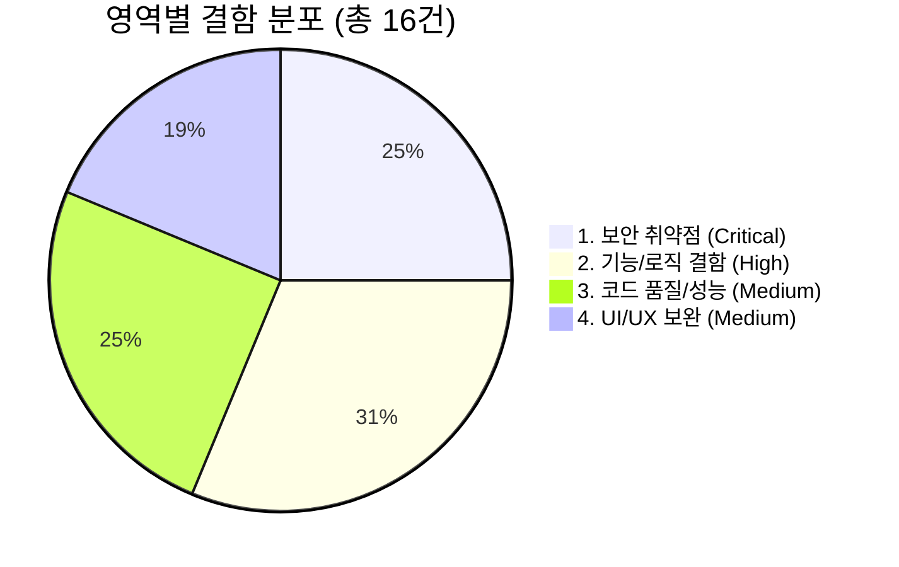
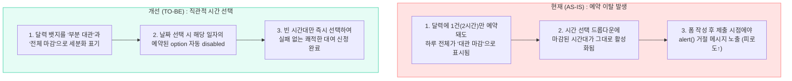

# 동네책방 아인(AYIN) 웹 애플리케이션 종합 기술 진단 보고서
**WEB APPLICATION SECURITY & ARCHITECTURE AUDIT REPORT**

* **분석 대상**: 클라이언트([index.html](file:///c:/Users/jini4/.gemini/antigravity/scratch/local-bookstore/index.html), [app.js](file:///c:/Users/jini4/.gemini/antigravity/scratch/local-bookstore/app.js)) 및 관리자([admin.html](file:///c:/Users/jini4/.gemini/antigravity/scratch/local-bookstore/admin.html), [admin.js](file:///c:/Users/jini4/.gemini/antigravity/scratch/local-bookstore/admin.js))
* **진단 기준일**: 2026. 10. 15

---

## 01 진단 개요 및 종합 평가 (Executive Summary)

본 보고서는 동네책방 아인(AYIN) 공식 웹사이트 및 관리자 대시보드의 소스 코드(HTML 2종, JS 2종, CSS 2종, 패키지 설정 1종)를 대상으로 수행한 정적 코드 분석 결과를 담고 있습니다. 

해당 시스템은 **Firebase(Firestore, Authentication)** 기반의 서버리스 아키텍처와 순수 자바스크립트(Vanilla ES6 Modules), Canvas API를 활용한 클라이언트 이미지 압축 등 현대적이고 실용적인 웹 기술을 충실히 구현하고 있습니다. 그러나 상용 운영 환경(Production) 배포 관점에서 점검한 결과, **관리자 권한 탈취로 이어질 수 있는 보안 취약점 4건**과 **예약 데이터 정합성을 훼손하는 로직 버그 5건** 등 총 **16건의 핵심 개선 과제**가 도출되었습니다.

### [그림 1] 영역별 발견 사항 분포 및 위험도 비중 (총 16건)
* **총 위험도 분포**: 🔴 **Critical 4건** / 🟠 **High 5건** / 🟡 **Medium 7건**



1. **보안 취약점 4건 (Critical - 즉시 패치 필수)**: Stored XSS, API Key 하드코딩, DB 초기화 권한 노출, 디버그 콘솔 노출
2. **기능/로직 결함 5건 (High - 단기 수정)**: 이벤트 리스너 중복 바인딩, 빠른 대관 중복 검증 누락, bookings 배열 식별자 부재, 타임존 요일 오차, 입력 폼 제약 불일치
3. **코드 품질/성능 4건 (Medium - 구조 개선)**: 직렬 쿼리 병목, 공통 모듈 미분리, 배치 삭제 미적용, 미사용 CSS
4. **UI/UX 보완 3건 (Medium - 사용성 향상)**: 예약 시간 선택 UX 병목, 갤러리 수정 버튼 누락, 플레이스홀더 데이터 잔존

---

## 02 분석 대상 파일 구성 및 아키텍처 현황 (System Inventory)

| 파일명 | 역할 및 계층 | 주요 구현 기능 및 특징 | 핵심 진단 상태 |
| :--- | :--- | :--- | :--- |
| [admin.js](file:///c:/Users/jini4/.gemini/antigravity/scratch/local-bookstore/admin.js) | 관리자 비즈니스 로직 | Firebase Auth 인증, 실시간 대관 구독(`onSnapshot`), ImgBB 이미지 압축 업로드, 스케줄/메뉴/큐레이션 제어 | 🔴 **보안/로직 취약** |
| [app.js](file:///c:/Users/jini4/.gemini/antigravity/scratch/local-bookstore/app.js) | 사용자 프론트엔드 로직 | Firestore 데이터 조회 및 폴백 처리, Scroll Spy 내비게이션, 도서/갤러리 모달 제어, 공간 대여 예약 신청 | 🔴 **XSS/권한 위험** |
| [index.html](file:///c:/Users/jini4/.gemini/antigravity/scratch/local-bookstore/index.html) | 사용자 메인 마크업 | 홈, 카페 메뉴, 도서 큐레이션, 갤러리, 원두 판매, 공간 대여 신청서, 오시는 길 및 영업 달력 | 🟡 **마크업/정책 불일치** |
| [admin.html](file:///c:/Users/jini4/.gemini/antigravity/scratch/local-bookstore/admin.html) | 관리자 대시보드 마크업 | 책방지기 로그인 게이트, 5대 관리 탭(대관, 메뉴, 큐레이션, 스케줄, 갤러리) 및 등록/수정 모달 4종 | 🟡 **UI 버튼 누락** |
| [styles.css](file:///c:/Users/jini4/.gemini/antigravity/scratch/local-bookstore/styles.css) /<br>[admin.css](file:///c:/Users/jini4/.gemini/antigravity/scratch/local-bookstore/admin.css) | 스타일시트 | 웜 베이지 & 딥 브라운 컬러 시스템, 반응형 미디어 쿼리, 슬라이더 및 모달 트랜지션, 테이블 레이아웃 | 🟢 **양호 (미사용 코드 존재)** |

---

## 03 치명적 보안 취약점 상세 분석 (Security Audit) 🔴 CRITICAL

클라이언트 사이드 렌더링(CSR)과 서버리스 DB(Firestore)를 결합한 구조에서는 브라우저에 노출되는 코드와 입력값 검증이 보안의 핵심입니다. 현재 코드베이스에서 즉시 수정이 필요한 4가지 보안 취약점은 다음과 같습니다.

### 1. Stored XSS (교차 사이트 스크립팅) `Critical`
* **대상**: [admin.js](file:///c:/Users/jini4/.gemini/antigravity/scratch/local-bookstore/admin.js) (375~403줄), [app.js](file:///c:/Users/jini4/.gemini/antigravity/scratch/local-bookstore/app.js) 전반
* **원인**: 사용자 입력 데이터를 이스케이프 없이 `innerHTML` 템플릿 리터럴로 DOM에 직접 주입합니다.
* **영향**: 방문자가 대여 신청서의 '성함'이나 '목적'란에 악성 스크립트(``)를 삽입해 제출하면, 관리자가 대시보드를 열람하는 즉시 스크립트가 실행되어 관리자 인증 세션 탈취 및 DB 조작이 가능합니다.

### 2. ImgBB API Key 평문 하드코딩 `Critical`
* **대상**: [admin.js](file:///c:/Users/jini4/.gemini/antigravity/scratch/local-bookstore/admin.js) (161줄 부근)
* **원인**: `cachedImgbbKey = "7472fcb4..."` 형태로 서드파티 이미지 호스팅 API 키가 소스 코드에 직접 노출되어 있습니다.
* **영향**: 정적 웹호스팅 환경에서는 비로그인 사용자도 브라우저 개발자 도구를 통해 `admin.js` 원문을 볼 수 있습니다. 키 탈취 시 외부인의 무단 이미지 업로드 및 API 쿼터 고갈 피해가 발생합니다.

### 3. 비인증 클라이언트의 DB 초기화 권한 `Critical`
* **대상**: [app.js](file:///c:/Users/jini4/.gemini/antigravity/scratch/local-bookstore/app.js) (132~162줄, 185줄 부근)
* **원인**: 일반 방문자용 스크립트에 Firestore 전체 초기 데이터를 덮어쓰는 `initializeDatabase()` 함수가 포함되어 있습니다.
* **영향**: 방문자 환경에서 쓰기 작업이 작동하도록 Firestore 보안 규칙(Security Rules)을 열어둘 경우, 누구나 브라우저 콘솔에서 `setDoc` / `deleteDoc`을 호출해 책방 메뉴와 일정을 임의로 파괴할 수 있습니다.

### 4. 운영 환경 디버그 콘솔 강제 노출 `High`
* **대상**: [app.js](file:///c:/Users/jini4/.gemini/antigravity/scratch/local-bookstore/app.js) (19~60줄), [admin.js](file:///c:/Users/jini4/.gemini/antigravity/scratch/local-bookstore/admin.js) (20~61줄)
* **원인**: 런타임 에러 및 `console.error`를 가로채 화면 우측 하단에 출력하는 디버그 오버레이가 상시 활성화되어 있습니다.
* **영향**: 일반 고객에게 내부 파일명, 라인 번호, DB 구조 에러가 노출되며, 에러 메시지 출력 시에도 `innerHTML +=`를 사용하여 DOM XSS 경로로 악용될 수 있습니다.

---

### 🛡️ 보안 패치 가이드라인: XSS 방어 및 Firestore 보안 규칙

1. **DOM 주입 방어**: 모든 동적 텍스트 바인딩 시 아래의 `escapeHTML()` 함수를 거치도록 수정하거나 `textContent`를 사용해야 합니다.
2. **API 키 은닉**: ImgBB API 키는 소스 코드에서 제거하고, Firestore 내 관리자 전용 문서(`config/secrets`)에 보관한 뒤 관리자 로그인 완료 후 불러오도록 분리하십시오.
3. **Security Rules 통제**: `app.js`에서 `initializeDatabase()`를 완전히 제거하고, Firestore 규칙에서 일반 사용자에게는 `rentals` 컬렉션의 `create`(생성)와 공개 컬렉션의 `read`(읽기)만 허용해야 합니다.

```javascript
// [권장 패치 코드 1] XSS 방어용 HTML 이스케이프 헬퍼 함수 (app.js / admin.js 공통 적용)
function escapeHTML(str) {
  if (str === null || str === undefined) return '';
  return String(str)
    .replace(/&/g, '&amp;')
    .replace(/</g, '&lt;')
    .replace(/>/g, '&gt;')
    .replace(/"/g, '&quot;')
    .replace(/'/g, '&#039;');
}
```

```javascript
// [권장 패치 코드 2] Firestore Security Rules 배포 스크립트 예시
rules_version = '2';
service cloud.firestore {
  match /databases/{database}/documents {
    // 1. 고객 대여 신청: 생성(쓰기)만 허용, 관리자만 열람/수정/삭제
    match /rentals/{rentalId} {
      allow create: if true;
      allow read, update, delete: if request.auth != null;
    }
    
    // 2. 민감 보안 설정: 관리자만 접근 허용 (ImgBB API 키 보관)
    match /config/secrets {
      allow read, write: if request.auth != null;
    }
    
    // 3. 일반 공개 콘텐츠: 누구나 읽기 가능, 수정은 관리자만 허용
    match /{document=**} {
      allow read: if true;
      allow write: if request.auth != null;
    }
  }
}
```

---

## 04 기능 및 비즈니스 로직 결함 (Functional Defects) 🟠 HIGH

예약 관리와 스케줄 달력 연동 과정에서 발견된 5가지 기능적 결함입니다. 특히 시간 중복 검증 누락과 이벤트 리스너 중첩은 실제 매장 운영 시 **이중 예약(Double Booking)** 사고를 유발할 수 있으므로 우선적인 보완이 필요합니다.

| 결함 항목 및 위치 | 발생 원인 및 문제 현상 | 기술적 해결 방안 |
| :--- | :--- | :--- |
| **달력 네비게이션 이벤트 리스너 중복 바인딩**<br>([admin.js:311, 882](file:///c:/Users/jini4/.gemini/antigravity/scratch/local-bookstore/admin.js#L311)) | `initDashboardData()` 호출 시마다 `initAdminCalendarControls()`가 실행되어 이전/다음 달 버튼에 클릭 리스너가 중복 등록됩니다. 재로그인이나 네트워크 재시도 후 버튼 클릭 시 달력이 한 번에 2~3개월씩 건너뜁니다. | 컨트롤러 이벤트 리스너 바인딩 로직을 `initDashboardData()` 밖으로 분리하여 스크립트 최초 로드 시 1회만 등록되도록 수정합니다. |
| **스케줄 모달 '빠른 대관 등록' 중복 검증 누락**<br>([admin.js:1076~1112](file:///c:/Users/jini4/.gemini/antigravity/scratch/local-bookstore/admin.js#L1076)) | 탭 1의 수동 예약 폼(`offlineForm`)에는 시간 겹침 검사(`hasOverlap`)가 존재하나, 탭 4 달력 날짜 클릭 모달의 `quickBookingForm`에는 중복 검사가 누락되어 이미 확정된 시간대에 중복 예약이 등록됩니다. | 시간대 겹침 검증 로직을 공통 함수 `isTimeSlotOverlapping(date, time, hours)`로 추출하여 두 등록 폼 모두에서 호출하도록 통일합니다. |
| **달력 bookings 배열의 식별자 부재 오류**<br>([admin.js:419~474](file:///c:/Users/jini4/.gemini/antigravity/scratch/local-bookstore/admin.js#L419)) | 달력 문서 동기화 시 예약 고유 ID(`rental.id`) 없이 `{ time, hours }`만 저장하고 취소 시 시간 값만으로 필터링합니다. 만약 동일 시간대에 2건의 데이터가 존재할 경우 1건만 취소해도 달력에서 모두 사라집니다. | 달력 `bookings` 배열 요소 구조를 `{ rentalId, time, hours }`로 확장하고, 취소 및 삭제 시 `rentalId`를 기준으로 정확히 매칭하여 제거합니다. |
| **UTC 기준 날짜 파싱으로 인한 요일 오차 위험**<br>([app.js:647](file:///c:/Users/jini4/.gemini/antigravity/scratch/local-bookstore/app.js#L647) / [admin.js:462](file:///c:/Users/jini4/.gemini/antigravity/scratch/local-bookstore/admin.js#L462)) | `new Date("2026-07-04").getDay()`처럼 하이픈 포맷 문자열을 전달하면 ES 명세상 로컬 시간이 아닌 UTC 자정으로 파싱됩니다. 실행 환경의 타임존에 따라 요일이 하루 밀려 주말 정기휴무 판정이 어긋날 수 있습니다. | 문자열을 `split('-').map(Number)`로 분해한 뒤 `new Date(y, m - 1, d).getDay()` 형태로 로컬 타임존을 명시하여 계산합니다. |
| **대여 안내 문구와 입력 폼 제약 조건 불일치**<br>([index.html:276, 318~322](file:///c:/Users/jini4/.gemini/antigravity/scratch/local-bookstore/index.html#L276)) | 안내문에는 "최대 20명, 최소 2시간부터 대여 가능"이라 명시되어 있으나, 실제 신청 폼과 관리자 폼의 `<input>` 속성은 이용 시간 `min="1"`, 인원 `max="12"`로 설정되어 있어 13~20명 단체 신청이 불가합니다. | 운영 정책에 맞춰 HTML 입력 필드의 속성을 `hours min="2"`, `people max="20"`으로 수정하고, 닫는 `</div>` 중복 태그(152줄)를 제거합니다. |

---

## 05 아키텍처 및 성능 최적화 방안 (Architecture & Performance) 🟡 OPTIMIZATION

1. **핵심 성능 병목: 순차적(Waterfall) Firestore 쿼리로 인한 초기 로딩 지연**
   - 현재 `app.js`의 `loadAllDataAndRender()`와 `admin.js`의 `initDashboardData()`는 `menu` → `keepers` → `books` → `calendar` → `gallery` 총 5개의 컬렉션을 직렬(`await` 순차 대기)로 호출하고 있습니다. 
   - 네트워크 왕복 지연(RTT)이 150ms일 경우 초기 화면 렌더링까지 최소 750ms 이상이 허비됩니다. 이를 **`Promise.all()` 병렬 조회로 전환**하면 가장 느린 단일 쿼리 시간(~150ms) 내에 모든 데이터 로드를 완료할 수 있습니다.

2. **공통 모듈 분리 (DRY 원칙 준수)**
   - `firebaseConfig` 초기화 객체와 약 150줄 분량의 기본 모형 데이터(`defaultKeepersData`, `defaultMenuData`, `defaultCalendarData`)가 `app.js`와 `admin.js`에 100% 중복 작성되어 있습니다.
   - `firebase-init.js` 파일을 신설하여 모듈로 `import` 하면 코드 중복을 제거하고 유지보수성을 크게 향상시킬 수 있습니다.

3. **다중 문서 삭제 시 원자성 보장 (`WriteBatch` 도입)**
   - `admin.js`의 `deleteKeeper()` (717~742줄)에서 책방지기 삭제 후 연관 도서를 지울 때 `for...of` 루프 안에서 개별 `deleteDoc()`을 호출하고 있습니다.
   - 루프 도중 네트워크 오류 발생 시 지기는 삭제되었으나 도서는 남아있는 데이터 고아(Orphan) 현상이 발생합니다. 이를 Firestore의 **`writeBatch()`로 묶어 원자적(Atomic)으로 일괄 삭제** 처리해야 합니다.

---

## 06 UI/UX 및 운영 편의성 보완점 (User & Admin Experience) 🟡 UX ENHANCEMENT

기능이 정상 동작하더라도 방문 고객의 예약 전환율을 떨어뜨리거나 관리자의 운영 피로도를 높이는 UX 설계 결함 3건이 확인되었습니다.

### [그림 2] 사용자 공간 대여 예약 프로세스의 UX 병목과 개선 흐름 비교



### 관리자 갤러리 수정 UI 누락 및 상용 콘텐츠(Placeholder) 점검
1. **갤러리 게시글 '수정' 버튼 누락 ([admin.js:1330~1355](file:///c:/Users/jini4/.gemini/antigravity/scratch/local-bookstore/admin.js#L1330))**:
   - `galleryUploadForm`의 submit 핸들러 내부(1300~1309줄)에는 `edit-gallery-id` 존재 여부에 따라 기존 게시글을 수정하는 분기 로직이 완벽히 구현되어 있습니다.
   - 그러나 정작 목록을 렌더링하는 `renderGalleryTab()`에는 `[삭제]` 버튼만 있고 `[수정]` 버튼이 빠져 있어, 오타 수정 시에도 게시글을 삭제 후 재업로드해야 하는 불편함이 있습니다.
2. **상용 데이터 및 시간대 정책 점검 ([index.html](file:///c:/Users/jini4/.gemini/antigravity/scratch/local-bookstore/index.html))**:
   - 원두 판매 섹션(`#shop`)의 상품 3종 이미지가 모두 `assets/space_interior.jpg`로 중복 지정되어 있고, 구매 링크가 네이버 스마트스토어 메인(`https://smartstore.naver.com/`)으로 연결되어 있어 실제 상품 링크로 연결해야 합니다.
   - 영업시간 안내는 `11:00 ~ 19:00`이나 대여 신청 가능 시간은 `10:00 ~ 21:00`으로 열려 있어 실제 매장 대관 정책과 맞는지 확인이 필요합니다.

---

## 07 단계별 개선 실행 로드맵 (Action Plan) 🚀

| 추진 단계 | 핵심 목표 | 세부 실행 내역 (Action Items) | 권장 일정 |
| :--- | :--- | :--- | :--- |
| **Phase 1**<br>긴급 보안 패치 | 권한 통제 및 취약점 제거 | • `escapeHTML()` 도입으로 전 구간 Stored XSS 차단<br>• `app.js`의 `initializeDatabase()` 제거 및 Firestore 보안 규칙 잠금<br>• ImgBB API 키 DB 분리 보관 및 프로덕션 디버그 콘솔 비활성화 | **배포 전 즉시**<br>(1~2일) |
| **Phase 2**<br>결함 수정 | 예약/달력 데이터 정합성 확보 | • 관리자 달력 컨트롤러 리스너 최초 1회 바인딩으로 분리<br>• 스케줄 모달 빠른 대관 등록 시 시간 중복 검증 로직 추가<br>• 달력 `bookings` 배열에 `rentalId` 부여 및 로컬 타임존 요일 계산 적용 | **단기**<br>(3~4일) |
| **Phase 3**<br>UX 및 마크업 | 고객 예약 편의성 및 UI 완성 | • 대여 날짜 선택 시 기예약 시간대 `<option>` 자동 비활성화 연동<br>• 관리자 갤러리 목록에 `[수정]` 버튼 추가 및 모달 데이터 바인딩<br>• 인원/시간 `min`/`max` 속성 일치화 및 실제 스마트스토어 URL 연결 | **중기**<br>(1주 이내) |
| **Phase 4**<br>구조 고도화 | 성능 최적화 및 모듈화 | • `Promise.all()` 기반 Firestore 초기 데이터 병렬 로딩 적용<br>• `WriteBatch` 도입 및 공통 설정/모형 데이터 모듈 분리 | **안정화 단계**<br>(2주 이내) |
