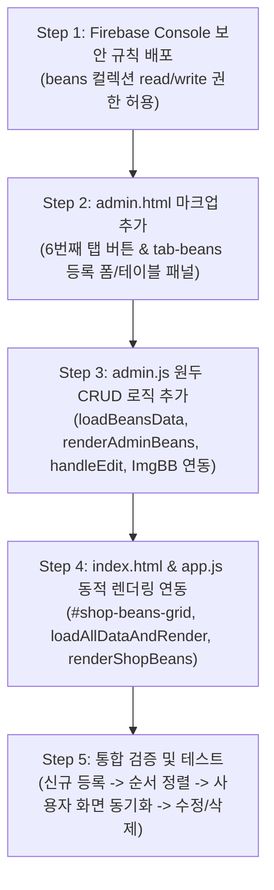

# 동네책방 아인 (AYIN) - 원두 및 굿즈 관리(Beans Management) 기능 개발 인수인계서 (Handover)

이 문서는 개발자가 IDE에서 동네책방 아인 관리자 대시보드(`admin.html`, `admin.js`, `admin.css`)에 **"원두/굿즈 관리(Shop & Beans Management)"** 기능을 신설하고, 메인 사이트(`index.html`, `app.js`)의 원두 판매 섹션을 Firestore 실시간 데이터와 동적으로 연동할 수 있도록 작성된 종합 기술 개발 인수인계서입니다.

---

## 1. 개요 및 개발 배경

### 1.1 현황 분석
- 현재 메인 웹사이트(`index.html`, lines 215-285)의 `#shop` 섹션은 3개의 원두/드립백 상품이 정적 HTML(하드코딩)로 렌더링되어 있습니다.
- 관리자 페이지(`admin.html`)에는 5개의 탭(`대관 예약`, `메뉴`, `큐레이션`, `스케줄`, `갤러리`)만 존재하여, 새로운 원두나 시즌 상품, 드립백 세트의 추가·수정·품절 처리를 위해서는 소스코드를 직접 수정해야 하는 한계가 있습니다.

### 1.2 개발 목표
1. **관리자 6번째 탭 신설**: `admin.html`에 `원두/굿즈 관리` (`tab-beans`) 탭 추가.
2. **원두/굿즈 CRUD 기능 구현**:
   - 상품 등록 (상품명, 상세설명, 가격, 배송비, 뱃지, 스마트스토어 링크, 노출 순서, 이미지).
   - 상품 이미지 업로드: **ImgBB Canvas 자동 압축 업로드** 및 **직접 이미지 URL 입력** 듀얼 지원.
   - 상품 수정 (Edit Mode) 및 삭제 (Delete with confirmation).
   - 노출 순서(`order`)에 따른 자동 정렬.
3. **Firestore 컬렉션 신설 & 보안 규칙 반영**:
   - `beans` 컬렉션 생성 및 권한 설정 (`read: if true`, `write: if request.auth != null`).
4. **사용자 화면 동적 렌더링 동기화**:
   - `app.js`에서 Firestore의 `beans` 데이터를 fetch하여 `#shop .shop-grid`에 동적으로 카드 생성.
   - 오프라인 또는 초기 상태를 위한 완벽한 Fallback 모형 데이터 제공.

---

## 2. 데이터베이스 스키마 및 보안 규칙

### 2.1 Firestore `beans` 컬렉션 스키마 명세
각 문서는 고유 Document ID(`auto-generated ID`)를 가집니다.

| 필드명 | 타입 | 필수 여부 | 기본값 | 설명 및 예시 |
| :--- | :--- | :---: | :--- | :--- |
| `name` | string | **Y** | - | 상품명 (예: `"아인 하우스 블렌드 원두 (200g)"`) |
| `desc` | string | **Y** | - | 상세 설명 (예: `"묵직한 바디감과 다크초콜릿 맛..."`) |
| `price` | number | **Y** | `0` | 판매 가격 (정수형 원화 단위, 예: `14000`) |
| `shippingFee` | number | N | `3000` | 배송비 (정수형 원화 단위, 기본 3,000원) |
| `badge` | string | N | `""` | 상품 태그/뱃지 (예: `"Best"`, `"MD 추천"`, `"시즌 한정"`, 공백 시 미노출) |
| `image` | string | **Y** | `assets/space_interior.jpg` | 상품 이미지 URL (ImgBB 업로드 URL 또는 외부 이미지 링크) |
| `storeUrl` | string | N | `https://smartstore.naver.com/` | 네이버 스마트스토어 또는 외부 구매 링크 |
| `order` | number | **Y** | `1` | 노출 순서 (정수형 오름차순 정렬, `1, 2, 3...`) |
| `isSoldOut` | boolean | N | `false` | 품절 여부 (선택 사항: 품절 시 구매 버튼 비활성화 등) |
| `updatedAt` | string | **Y** | ISO String | 최종 갱신 일시 (예: `"2026-10-23T14:00:00Z"`) |

### 2.2 Firebase Security Rules 업데이트
Firebase 콘솔의 Firestore 규칙 탭에 `beans` 컬렉션 규칙을 추가합니다.

```javascript
rules_version = '2';
service cloud.firestore {
  match /databases/{database}/documents {

    // 1. 일반 공개 데이터 (메뉴, 지기, 도서, 달력, 갤러리 + [신규] 원두)
    match /config/menu {
      allow read: if true;
      allow write: if request.auth != null;
    }

    match /keepers/{keeperId} {
      allow read: if true;
      allow write: if request.auth != null;
    }

    match /books/{bookId} {
      allow read: if true;
      allow write: if request.auth != null;
    }

    match /calendar/{date} {
      allow read: if true;
      allow write: if request.auth != null;
    }

    match /gallery/{docId} {
      allow read: if true;
      allow write: if request.auth != null;
    }

    // [신규 추가] 원두/굿즈 컬렉션 보안 규칙
    match /beans/{beanId} {
      allow read: if true;
      allow write: if request.auth != null;
    }

    // 2. 외부 API 키 문서 (ImgBB 등)
    match /config/keys {
      allow read, write: if request.auth != null;
    }

    // 3. 대관 예약 신청 (rentals)
    match /rentals/{rentalId} {
      allow create: if true;
      allow read, update, delete: if request.auth != null;
    }
  }
}
```

---

## 3. 세부 파일별 구현 계획

### 3.1 [admin.html](file:///c:/Users/jini4/.gemini/antigravity/scratch/local-bookstore/admin.html)

#### ① 탭 내비게이션에 6번째 버튼 추가 (line 75 뒤)
```html
<nav class="admin-tabs" aria-label="관리자 탭 메뉴">
  <button class="admin-tab-btn active" data-target="tab-rentals"><i class="fa-solid fa-calendar-check"></i> 대관 예약 관리</button>
  <button class="admin-tab-btn" data-target="tab-menus"><i class="fa-solid fa-utensils"></i> 메뉴 관리</button>
  <button class="admin-tab-btn" data-target="tab-curation"><i class="fa-solid fa-book-open"></i> 큐레이션 관리</button>
  <button class="admin-tab-btn" data-target="tab-schedule"><i class="fa-solid fa-calendar-days"></i> 스케줄 관리</button>
  <button class="admin-tab-btn" data-target="tab-gallery"><i class="fa-solid fa-images"></i> 갤러리 관리</button>
  <!-- [신규 추가] 원두/굿즈 관리 탭 버튼 -->
  <button class="admin-tab-btn" data-target="tab-beans"><i class="fa-solid fa-mug-hot"></i> 원두/굿즈 관리</button>
</nav>
```

#### ② `tab-beans` 콘텐츠 섹션 추가
`tab-gallery` 섹션 바로 뒤에 다음 마크업을 삽입합니다.

```html
<!-- ==========================================================================
     탭 6: 원두 및 굿즈 관리
     ========================================================================== -->
<section class="admin-tab-content" id="tab-beans">
  <div class="card-panel">
    <div class="panel-header">
      <h2>원두 및 굿즈 상품 등록/수정</h2>
    </div>

    <!-- 상품 등록/수정 폼 -->
    <form id="form-manage-bean" style="display: flex; flex-direction: column; gap: 16px; margin-bottom: 30px; border-bottom: 1px solid var(--border-color); padding-bottom: 24px;">
      <input type="hidden" id="bean-doc-id">

      <div class="admin-form-row" style="display: flex; flex-wrap: wrap; gap: 16px;">
        <div class="admin-form-group" style="flex: 2; min-width: 240px; margin-bottom: 0;">
          <label for="bean-name">상품명 *</label>
          <input type="text" id="bean-name" placeholder="예: 아인 하우스 블렌드 원두 (200g)" required>
        </div>
        <div class="admin-form-group" style="flex: 1; min-width: 140px; margin-bottom: 0;">
          <label for="bean-badge">상품 뱃지</label>
          <input type="text" id="bean-badge" placeholder="예: Best, MD 추천, 시즌한정 (선택)">
        </div>
        <div class="admin-form-group" style="width: 100px; margin-bottom: 0;">
          <label for="bean-order">노출 순서 *</label>
          <input type="number" id="bean-order" value="1" min="1" required>
        </div>
      </div>

      <div class="admin-form-row" style="display: flex; flex-wrap: wrap; gap: 16px;">
        <div class="admin-form-group" style="flex: 1; min-width: 160px; margin-bottom: 0;">
          <label for="bean-price">판매 가격 (원) *</label>
          <input type="number" id="bean-price" placeholder="14000" min="0" step="500" required>
        </div>
        <div class="admin-form-group" style="flex: 1; min-width: 160px; margin-bottom: 0;">
          <label for="bean-shipping">배송비 (원)</label>
          <input type="number" id="bean-shipping" value="3000" min="0" step="500">
        </div>
        <div class="admin-form-group" style="flex: 2; min-width: 240px; margin-bottom: 0;">
          <label for="bean-store-url">스마트스토어 구매 링크</label>
          <input type="url" id="bean-store-url" placeholder="https://smartstore.naver.com/..." value="https://smartstore.naver.com/">
        </div>
      </div>

      <!-- 이미지 듀얼 업로드 옵션 -->
      <div class="admin-form-group" style="margin-bottom: 0;">
        <label>상품 이미지 등록 (파일 직접 업로드 또는 URL 입력) *</label>
        <div style="display: flex; gap: 12px; align-items: center; flex-wrap: wrap;">
          <input type="file" id="bean-image-file" accept="image/*" style="flex: 1; min-width: 200px;">
          <span style="color: var(--text-muted); font-size: 0.85rem;">또는</span>
          <input type="url" id="bean-image-url" placeholder="이미지 URL 직접 입력 (https://...)" style="flex: 2; min-width: 240px;">
        </div>
        <div id="bean-image-preview-wrapper" style="margin-top: 10px; display: none;">
          
        </div>
      </div>

      <!-- 상세 설명 -->
      <div class="admin-form-group" style="margin-bottom: 0;">
        <label for="bean-desc">상품 상세 설명 *</label>
        <textarea id="bean-desc" rows="3" placeholder="묵직한 바디감과 다크초콜릿 맛. 아침 독서용으로 가장 많은 분들이 찾는 시그니처 원두" required></textarea>
      </div>

      <!-- 제출 및 취소 버튼 -->
      <div style="display: flex; gap: 10px; justify-content: flex-end; align-items: center; margin-top: 8px;">
        <button type="button" class="btn-action" id="btn-cancel-bean-edit" style="display: none; background-color: var(--text-muted); color: #FFFFFF; height: 44px; padding: 0 20px;">
          수정 취소
        </button>
        <button type="submit" class="btn-primary-form" id="btn-submit-bean" style="height: 44px; margin-bottom: 0; min-width: 140px;">
          <i class="fa-solid fa-plus"></i> 새 상품 등록
        </button>
      </div>
    </form>

    <!-- 등록된 원두 목록 테이블 -->
    <div class="panel-header" style="margin-top: 16px;">
      <h2>등록된 상품 목록 (<span id="beans-total-count">0</span>개)</h2>
    </div>
    <div class="table-wrapper">
      <table class="admin-table">
        <thead>
          <tr>
            <th style="width: 8%; min-width: 50px;">순서</th>
            <th style="width: 12%; min-width: 80px;">이미지</th>
            <th style="width: 25%; min-width: 160px;">상품명 / 뱃지</th>
            <th style="width: 25%; min-width: 160px;">상세 설명</th>
            <th style="width: 15%; min-width: 110px;">가격 / 배송비</th>
            <th style="width: 15%; min-width: 120px;">관리</th>
          </tr>
        </thead>
        <tbody id="beans-table-body">
          <!-- JS에서 동적 주입 -->
        </tbody>
      </table>
    </div>
  </div>
</section>
```

---

### 3.2 [admin.js](file:///c:/Users/jini4/.gemini/antigravity/scratch/local-bookstore/admin.js)

#### ① 기본 모형 데이터 (`defaultBeansData`) 정의
`defaultKeepersData`, `defaultMenuData` 선언부 부근에 추가합니다.

```javascript
const defaultBeansData = [
  {
    id: "bean-1",
    name: "아인 하우스 블렌드 원두 (200g)",
    desc: "묵직한 바디감과 다크초콜릿 맛. 아침 독서용으로 가장 많은 분들이 찾는 시그니처 원두",
    price: 14000,
    shippingFee: 3000,
    badge: "Best",
    image: "assets/space_interior.jpg",
    storeUrl: "https://smartstore.naver.com/",
    order: 1,
    updatedAt: "2026-07-01T00:00:00Z"
  },
  {
    id: "bean-2",
    name: "에티오피아 예가체프 원두 (200g)",
    desc: "화사한 꽃향기와 과일 맛. 기분 좋은 산미를 즐기는 분들께 추천하는 싱글오리진",
    price: 16000,
    shippingFee: 3000,
    badge: "",
    image: "assets/space_interior.jpg",
    storeUrl: "https://smartstore.naver.com/",
    order: 2,
    updatedAt: "2026-07-01T00:00:00Z"
  },
  {
    id: "bean-3",
    name: "아인 드립백 셀렉션 (8개입)",
    desc: "하우스 블렌드 4개 + 에티오피아 4개 구성. 뜨거운 물만 부어 간편하게 내리는 고품격 커피 타임",
    price: 12000,
    shippingFee: 3000,
    badge: "MD 추천",
    image: "assets/space_interior.jpg",
    storeUrl: "https://smartstore.naver.com/",
    order: 3,
    updatedAt: "2026-07-01T00:00:00Z"
  }
];

let beansData = [];
```

#### ② 데이터 로드 및 렌더링 함수 구현
`fetchInitialData` 또는 데이터 초기화 파이프라인에 `loadBeansData()` 연결:

```javascript
async function loadBeansData() {
  try {
    const snap = await getDocs(collection(db, "beans"));
    beansData = [];
    snap.forEach(docSnap => {
      beansData.push({ id: docSnap.id, ...docSnap.data() });
    });

    if (beansData.length === 0) {
      // 초기 상태: Firestore 컬렉션이 비어있는 경우 디폴트 3개 표시
      beansData = [...defaultBeansData];
    }

    beansData.sort((a, b) => (Number(a.order) || 0) - (Number(b.order) || 0));
    renderAdminBeans();
  } catch (err) {
    console.error("원두 목록 로드 실패:", err);
    beansData = [...defaultBeansData];
    renderAdminBeans();
  }
}

function renderAdminBeans() {
  const tbody = document.getElementById('beans-table-body');
  const countEl = document.getElementById('beans-total-count');
  if (!tbody) return;

  if (countEl) countEl.textContent = beansData.length;

  if (beansData.length === 0) {
    tbody.innerHTML = `<tr><td colspan="6" style="text-align: center; color: var(--text-muted); padding: 32px 0;">등록된 원두/굿즈 상품이 없습니다.</td></tr>`;
    return;
  }

  tbody.innerHTML = beansData.map(b => `
    <tr data-id="${escapeHTML(b.id)}">
      <td style="text-align: center; font-weight: 600; color: var(--color-primary);">${Number(b.order) || 1}</td>
      <td style="text-align: center;">
        
      </td>
      <td>
        <div style="font-weight: 600; color: var(--color-primary);">${escapeHTML(b.name)}</div>
        ${b.badge ? `<span style="display: inline-block; font-size: 0.75rem; background: var(--color-accent); color: white; padding: 2px 6px; border-radius: 4px; margin-top: 4px;">${escapeHTML(b.badge)}</span>` : ''}
      </td>
      <td style="font-size: 0.88rem; color: var(--text-muted); line-height: 1.4;">
        ${escapeHTML(b.desc)}
      </td>
      <td>
        <div style="font-weight: 600;">${Number(b.price || 0).toLocaleString()}원</div>
        <div style="font-size: 0.8rem; color: var(--text-muted);">배송비 ${Number(b.shippingFee || 3000).toLocaleString()}원</div>
      </td>
      <td>
        <div style="display: flex; gap: 6px;">
          <button class="btn-action btn-edit-bean" data-id="${escapeHTML(b.id)}" style="background: var(--color-primary); color: white;">
            <i class="fa-solid fa-pen-to-square"></i> 수정
          </button>
          <button class="btn-action btn-delete-bean" data-id="${escapeHTML(b.id)}" style="background: var(--color-terracotta); color: white;">
            <i class="fa-solid fa-trash"></i> 삭제
          </button>
        </div>
      </td>
    </tr>
  `).join('');

  // 이벤트 바인딩: 수정 및 삭제
  tbody.querySelectorAll('.btn-edit-bean').forEach(btn => {
    btn.addEventListener('click', () => handleEditBean(btn.dataset.id));
  });
  tbody.querySelectorAll('.btn-delete-bean').forEach(btn => {
    btn.addEventListener('click', () => handleDeleteBean(btn.dataset.id));
  });
}
```

#### ③ 상품 등록/수정/삭제 이벤트 핸들러
```javascript
// 수정 모드 진입
function handleEditBean(id) {
  const item = beansData.find(b => b.id === id);
  if (!item) return;

  document.getElementById('bean-doc-id').value = item.id;
  document.getElementById('bean-name').value = item.name || '';
  document.getElementById('bean-badge').value = item.badge || '';
  document.getElementById('bean-order').value = item.order || 1;
  document.getElementById('bean-price').value = item.price || 0;
  document.getElementById('bean-shipping').value = item.shippingFee !== undefined ? item.shippingFee : 3000;
  document.getElementById('bean-store-url').value = item.storeUrl || 'https://smartstore.naver.com/';
  document.getElementById('bean-image-url').value = item.image || '';
  document.getElementById('bean-desc').value = item.desc || '';

  // 미리보기 갱신
  const preview = document.getElementById('bean-image-preview');
  const previewWrapper = document.getElementById('bean-image-preview-wrapper');
  if (item.image) {
    preview.src = item.image;
    previewWrapper.style.display = 'block';
  } else {
    previewWrapper.style.display = 'none';
  }

  // 폼 UI를 '수정 모드'로 변경
  document.getElementById('btn-submit-bean').innerHTML = `<i class="fa-solid fa-check"></i> 수정사항 저장`;
  document.getElementById('btn-cancel-bean-edit').style.display = 'inline-block';

  // 폼 상단으로 부드럽게 스크롤
  document.getElementById('form-manage-bean').scrollIntoView({ behavior: 'smooth' });
}

// 수정 취소
function resetBeanForm() {
  const form = document.getElementById('form-manage-bean');
  if (!form) return;
  form.reset();
  document.getElementById('bean-doc-id').value = '';
  document.getElementById('bean-shipping').value = '3000';
  document.getElementById('bean-order').value = (beansData.length + 1).toString();
  document.getElementById('bean-image-preview-wrapper').style.display = 'none';
  document.getElementById('btn-submit-bean').innerHTML = `<i class="fa-solid fa-plus"></i> 새 상품 등록`;
  document.getElementById('btn-cancel-bean-edit').style.display = 'none';
}

// 폼 서밋 핸들러 (ImgBB 압축 업로드 + Firestore 저장)
async function setupBeanFormEvents() {
  const form = document.getElementById('form-manage-bean');
  const cancelBtn = document.getElementById('btn-cancel-bean-edit');
  const fileInput = document.getElementById('bean-image-file');
  const urlInput = document.getElementById('bean-image-url');
  const preview = document.getElementById('bean-image-preview');
  const previewWrapper = document.getElementById('bean-image-preview-wrapper');

  if (cancelBtn) cancelBtn.addEventListener('click', resetBeanForm);

  // URL 입력 시 미리보기 동기화
  if (urlInput) {
    urlInput.addEventListener('input', () => {
      if (urlInput.value.trim()) {
        preview.src = urlInput.value.trim();
        previewWrapper.style.display = 'block';
      } else {
        previewWrapper.style.display = 'none';
      }
    });
  }

  // 파일 선택 시 로컬 미리보기
  if (fileInput) {
    fileInput.addEventListener('change', () => {
      const file = fileInput.files[0];
      if (file) {
        const reader = new FileReader();
        reader.onload = (e) => {
          preview.src = e.target.result;
          previewWrapper.style.display = 'block';
        };
        reader.readAsDataURL(file);
      }
    });
  }

  if (form) {
    form.addEventListener('submit', async (e) => {
      e.preventDefault();
      const submitBtn = document.getElementById('btn-submit-bean');
      const originalText = submitBtn.innerHTML;
      submitBtn.disabled = true;
      submitBtn.innerHTML = `<i class="fa-solid fa-spinner fa-spin"></i> 저장 중...`;

      try {
        const docId = document.getElementById('bean-doc-id').value.trim();
        let imageUrl = urlInput.value.trim();

        // 파일이 선택된 경우 ImgBB 업로드 처리 (기존 uploadToImgBB 유틸 활용)
        if (fileInput.files.length > 0) {
          imageUrl = await uploadImageWithCompression(fileInput.files[0]);
        }

        if (!imageUrl) {
          imageUrl = 'assets/space_interior.jpg';
        }

        const beanData = {
          name: document.getElementById('bean-name').value.trim(),
          badge: document.getElementById('bean-badge').value.trim(),
          order: Number(document.getElementById('bean-order').value) || 1,
          price: Number(document.getElementById('bean-price').value) || 0,
          shippingFee: Number(document.getElementById('bean-shipping').value) || 0,
          storeUrl: document.getElementById('bean-store-url').value.trim() || 'https://smartstore.naver.com/',
          image: imageUrl,
          desc: document.getElementById('bean-desc').value.trim(),
          updatedAt: new Date().toISOString()
        };

        if (docId && !docId.startsWith('bean-')) {
          // 기존 Firestore 문서 수정
          await updateDoc(doc(db, "beans", docId), beanData);
          showToast("상품 정보가 성공적으로 수정되었습니다.", "success");
        } else {
          // 신규 추가 (또는 default mock을 Firestore에 최초 저장)
          const newDocRef = await addDoc(collection(db, "beans"), beanData);
          beanData.id = newDocRef.id;
          showToast("새로운 상품이 성공적으로 등록되었습니다.", "success");
        }

        resetBeanForm();
        await loadBeansData();
      } catch (err) {
        console.error("상품 저장 실패:", err);
        showToast("상품 저장에 실패했습니다. " + err.message, "error");
      } finally {
        submitBtn.disabled = false;
        submitBtn.innerHTML = originalText;
      }
    });
  }
}

// 상품 삭제 핸들러
async function handleDeleteBean(id) {
  if (!confirm("정말 이 상품을 삭제하시겠습니까?")) return;

  try {
    if (!id.startsWith('bean-')) {
      await deleteDoc(doc(db, "beans", id));
    }
    beansData = beansData.filter(b => b.id !== id);
    renderAdminBeans();
    showToast("상품이 삭제되었습니다.", "success");
  } catch (err) {
    console.error("상품 삭제 실패:", err);
    showToast("삭제 실패: " + err.message, "error");
  }
}
```

---

### 3.3 [index.html](file:///c:/Users/jini4/.gemini/antigravity/scratch/local-bookstore/index.html)

기존 `#shop` 섹션(lines 216-285)의 `.shop-grid`에 식별용 ID `#shop-beans-grid`를 부여하고, 초기 로딩 또는 JS 미작동 시에도 레이아웃이 깨지지 않도록 유지합니다:

```html
<!-- 4. 원두 숍 섹션 (Beans) -->
<section id="shop" class="shop-section">
  <div class="container">
    <div class="section-header">
      <span class="sub-title">Roasting Beans</span>
      <h2>원두 판매</h2>
      <div class="section-divider"></div>
      <p class="section-intro">아인에서 매일 아침 정성껏 로스팅한 스페셜티 원두와 드립백을 집에서도 그대로 즐겨보세요.</p>
    </div>

    <!-- 동적 렌더링 컨테이너: id="shop-beans-grid" 지정 -->
    <div class="shop-grid" id="shop-beans-grid">
      <!-- JS loadAllDataAndRender()에서 Firestore 데이터를 가져와 동적으로 카드를 주입합니다 -->
    </div>
  </div>
</section>
```

---

### 3.4 [app.js](file:///c:/Users/jini4/.gemini/antigravity/scratch/local-bookstore/app.js)

#### ① 데이터 선언 및 `Promise.all` 로딩에 `beans` 추가
```javascript
// 상단 데이터 변수 선언
let beansData = [];

// loadAllDataAndRender() 내부 수정
async function loadAllDataAndRender() {
  ...
  try {
    const [menuSnap, keepersSnap, booksSnap, calendarSnap, gallerySnap, beansSnap] = await Promise.all([
      getDoc(doc(db, "config", "menu")),
      getDocs(collection(db, "keepers")),
      getDocs(collection(db, "books")),
      getDocs(collection(db, "calendar")),
      getDocs(collection(db, "gallery")).catch(err => ({ forEach: () => {} })),
      getDocs(collection(db, "beans")).catch(err => {
        console.warn("Failed to load beans:", err);
        return { forEach: () => {} };
      })
    ]);

    // 6. beans 로드
    beansData = [];
    beansSnap.forEach(d => {
      beansData.push({ id: d.id, ...d.data() });
    });
    if (beansData.length === 0) {
      beansData = defaultBeansData;
    } else {
      beansData.sort((a, b) => (Number(a.order) || 0) - (Number(b.order) || 0));
    }

    // 렌더링 호출
    renderShopBeans();
  ...
```

#### ② 메인 화면 원두 상품 렌더러 (`renderShopBeans`)
```javascript
function renderShopBeans() {
  const grid = document.getElementById('shop-beans-grid');
  if (!grid) return;

  if (beansData.length === 0) {
    grid.innerHTML = `<p style="grid-column: 1/-1; text-align: center; color: var(--text-muted); padding: 40px 0;">현재 준비 중인 상품이 없습니다.</p>`;
    return;
  }

  grid.innerHTML = beansData.map(item => `
    <div class="product-card" id="product-card-${escapeHTML(item.id)}">
      <div class="product-img-wrapper">
        
        ${item.badge ? `<div class="product-badge">${escapeHTML(item.badge)}</div>` : ''}
      </div>
      <div class="product-detail">
        <h3 class="product-name">${escapeHTML(item.name)}</h3>
        <p class="product-desc">${escapeHTML(item.desc)}</p>
        <div class="product-price-row">
          <span class="price">${Number(item.price || 0).toLocaleString()}원</span>
          <span class="shipping-info">배송비 ${Number(item.shippingFee || 3000).toLocaleString()}원</span>
        </div>
        <div class="product-actions">
          <a href="${escapeHTML(item.storeUrl || 'https://smartstore.naver.com/')}" target="_blank" rel="noopener noreferrer" class="btn-smartstore">
            <i class="fa-solid fa-shopping-bag"></i> 네이버 스토어 구매
          </a>
        </div>
      </div>
    </div>
  `).join('');
}
```

---

## 4. UI 및 반응형 스타일 가이드 ([admin.css](file:///c:/Users/jini4/.gemini/antigravity/scratch/local-bookstore/admin.css))

어드민의 폼 필드와 테이블이 반응형 모바일(768px 이하)에서도 깔끔하게 렌더링될 수 있도록 다음 CSS 규칙이 보장되어야 합니다:

```css
/* 원두/굿즈 관리 폼 스타일 보강 */
#form-manage-bean input[type="text"],
#form-manage-bean input[type="number"],
#form-manage-bean input[type="url"],
#form-manage-bean textarea {
  width: 100%;
  padding: 10px 12px;
  border: 1px solid var(--border-color);
  border-radius: 6px;
  background-color: var(--bg-card);
  font-family: inherit;
  font-size: 0.95rem;
  color: var(--text-main);
  transition: border-color 0.2s, box-shadow 0.2s;
}

#form-manage-bean input:focus,
#form-manage-bean textarea:focus {
  outline: none;
  border-color: var(--color-accent);
  box-shadow: 0 0 0 3px rgba(184, 115, 51, 0.15);
}

#form-manage-bean textarea {
  resize: vertical;
  min-height: 70px;
}

/* 상품 썸네일 미리보기 */
#bean-image-preview-wrapper {
  background: var(--bg-main);
  padding: 8px;
  border-radius: 6px;
  display: inline-block;
}
```

---

## 5. 단계별 작업 로드맵 (Step-by-Step Implementation Guide)



1. **Step 1: 보안 규칙 업데이트**
   - Firebase 콘솔 또는 프로젝트 루트의 보안 규칙 파일에 `match /beans/{beanId}` 추가 및 게시.
2. **Step 2: [admin.html](file:///c:/Users/jini4/.gemini/antigravity/scratch/local-bookstore/admin.html) 편집**
   - 탭 버튼 `<button class="admin-tab-btn" data-target="tab-beans">` 삽입.
   - `<section class="admin-tab-content" id="tab-beans">` 등록/수정 폼 및 테이블 추가.
3. **Step 3: [admin.js](file:///c:/Users/jini4/.gemini/antigravity/scratch/local-bookstore/admin.js) 편집**
   - `defaultBeansData`, `beansData` 전역 변수 선언.
   - `loadBeansData()`, `renderAdminBeans()`, `setupBeanFormEvents()`, `handleDeleteBean()` 구현.
   - 로그인 인증 통과 시 `loadBeansData()` 및 `setupBeanFormEvents()` 호출.
4. **Step 4: [index.html](file:///c:/Users/jini4/.gemini/antigravity/scratch/local-bookstore/index.html) & [app.js](file:///c:/Users/jini4/.gemini/antigravity/scratch/local-bookstore/app.js) 편집**
   - `index.html`: `#shop .shop-grid`에 `id="shop-beans-grid"` 추가.
   - `app.js`: `loadAllDataAndRender()`의 `Promise.all`에 `getDocs(collection(db, "beans"))` 추가 및 `renderShopBeans()` 구현.
5. **Step 5: 로컬 및 실서버 테스트**
   - `http://localhost:3005/admin.html`에서 탭 진입, 신규 원두 등록, 순서 변경, 메인 화면 실시간 반영 검증.

---

## 6. 검증 시나리오 (Verification Scenarios)

| # | 시나리오 | 수행 절차 | 기대 결과 |
| :---: | :--- | :--- | :--- |
| **1** | **탭 전환 확인** | 관리자 페이지 접속 후 6번째 [원두/굿즈 관리] 탭 클릭 | 활성 탭이 전환되며 상품 등록 폼과 목록 테이블이 정상 표시된다. |
| **2** | **기본 데이터 로드** | Firestore에 데이터가 없는 초기 상태로 진입 | 기본 3개 원두(하우스 블렌드, 예가체프, 드립백)가 테이블에 정상 렌더링된다. |
| **3** | **신규 상품 등록** | 상품명("콜롬비아 디카페인"), 가격(15,000), 순서(4), 이미지 업로드 후 등록 클릭 | 토스트 메시지가 뜨며 테이블에 4번째 상품으로 즉시 추가되고 Firestore에 저장된다. |
| **4** | **상품 수정 (Edit Mode)** | 특정 상품의 `[수정]` 버튼 클릭 | 폼에 기존 정보가 자동 채워지고 버튼이 '수정사항 저장'으로 변경되며, 수정 후 저장 시 테이블 내용이 갱신된다. |
| **5** | **노출 순서 재정렬** | 순서 값을 변경(예: 4 -> 1)하여 저장 | 테이블 및 메인 화면에서 1번 자리에 해당 상품이 가장 먼저 노출된다. |
| **6** | **사용자 화면 실시간 동기화** | 메인 페이지(`index.html`) 새로고침 | `#shop` 섹션에 관리자에서 등록·수정한 상품 목록과 뱃지, 가격, 링크가 온전히 일치하여 렌더링된다. |
| **7** | **상품 삭제** | 테이블에서 `[삭제]` 클릭 후 컨펌 확인 | Firestore 및 로컬 리스트에서 제거되며 목록에서 사라진다. |
