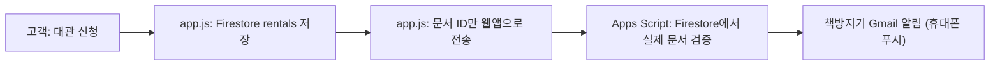

# 대관 신청 Gmail 알림 설정 가이드

고객이 홈페이지에서 대관을 신청하면 **책방지기 Gmail로 바로 알림 메일**이 가도록 설정하는 방법입니다.
Firebase 무료(Spark) 요금제를 그대로 쓰며, 추가 비용은 없습니다.



> [!IMPORTANT]
> 아래 작업은 **Firebase 프로젝트(ayin-bookstore)를 만든 Google 계정**으로 로그인해서 진행하세요.
> 다른 계정으로 하면 Firestore 조회 권한이 없어 메일이 발송되지 않습니다.

---

## 1단계. Apps Script 프로젝트 만들기 (약 3분)

1. https://script.google.com 접속 → **[새 프로젝트]**
2. 왼쪽 위 제목 "제목 없는 프로젝트"를 `아인 대관 알림`으로 변경
3. 기본으로 있는 `Code.gs` 내용을 전부 지우고, [apps-script/rental-notify.gs](../apps-script/rental-notify.gs) 내용을 **전체 복사 → 붙여넣기**
4. 왼쪽 톱니바퀴 **[프로젝트 설정]** → **"편집기에서 'appsscript.json' 매니페스트 파일 표시"** 체크
5. 다시 **[편집기]**로 돌아와 `appsscript.json`을 열고, [apps-script/appsscript.json](../apps-script/appsscript.json) 내용으로 **전체 교체**
6. `Ctrl + S` 저장

> [!TIP]
> 알림 받을 메일을 따로 지정하려면 `rental-notify.gs` 상단 `CONFIG.NOTIFY_EMAIL`에 입력하세요. (여러 명이면 쉼표로 구분)
> `CONFIG.ADMIN_URL`에 관리자 페이지 주소를 넣으면 메일에 바로가기 버튼이 생깁니다.

## 2단계. 설정 점검 (약 1분)

1. 편집기 상단 함수 선택 드롭다운에서 `testSetup` 선택 → **[실행]**
2. 권한 승인 창이 뜨면: **[권한 검토]** → 계정 선택 → "Google에서 확인하지 않은 앱" 화면에서 **[고급] → [아인 대관 알림(으)로 이동]** → **[허용]**
   - 본인이 만든 스크립트라 뜨는 정상 경고입니다.
3. 하단 실행 로그에서 확인:
   - `Firestore 접근 응답 코드: 200 (정상)` ✅
   - Gmail에 `[아인] 대관 알림 설정 테스트` 메일 도착 ✅

> [!WARNING]
> 응답 코드가 `403`이면 지금 로그인한 계정에 Firebase 프로젝트 권한이 없는 것입니다.
> Firebase 콘솔 → 프로젝트 설정 → **사용자 및 권한**에서 이 계정을 **소유자(Owner)** 또는 **편집자(Editor)**로 추가한 뒤 다시 실행하세요.

## 3단계. 웹앱으로 배포 (약 2분)

1. 오른쪽 위 **[배포] → [새 배포]**
2. 유형 선택(톱니바퀴) → **웹 앱**
3. 설정:
   - 다음 사용자 인증 정보로 실행: **나**
   - 액세스 권한이 있는 사용자: **모든 사용자**
4. **[배포]** → 표시되는 **웹 앱 URL** 복사 (`https://script.google.com/macros/s/..../exec` 형태)
5. 복사한 URL을 브라우저 새 탭에 붙여넣어 열었을 때 `ok`가 보이면 성공

## 4단계. 홈페이지에 URL 연결 (30초)

[app.js](../app.js) 상단의 아래 줄에 3단계에서 복사한 URL을 붙여넣습니다.

```javascript
const RENTAL_NOTIFY_URL = 'https://script.google.com/macros/s/여기에_복사한_ID/exec';
```

## 5단계. 실제 테스트

1. 홈페이지에서 평일 날짜로 대관 신청 제출
2. 1분 이내에 Gmail로 `[아인 대관 신청] 날짜 시간 · 이름님` 메일 도착 확인
3. 휴대폰 Gmail 앱 알림이 켜져 있는지 확인 (설정 → 해당 계정 → 알림: **모두**)

---

## 보안 설계 메모

| 위협 | 대응 |
|---|---|
| 웹앱 URL이 공개되어 누군가 가짜 요청으로 메일 폭탄 | 문서 ID만 받고 **Firestore에 실제로 존재하는 신청서인지** 소유자 권한으로 확인 후 발송 |
| 오래된 신청 ID를 반복 전송 | 생성 15분 이내 + `pending`/`online` 상태만 발송, 같은 ID는 6시간 동안 1회만 발송 |
| 개인정보 노출 | 브라우저 → 웹앱 구간에는 문서 ID만 전송되며, 이름·연락처는 전송되지 않음 |
| 알림 실패 시 고객 신청 실패 | 알림은 저장 성공 **이후** 별도로 전송되고 결과를 기다리지 않으므로, 실패해도 신청은 정상 접수 |

## 코드 수정 시 주의

- `rental-notify.gs`를 수정했다면 **[배포] → [배포 관리] → 연필 아이콘 → 버전: 새 버전 → [배포]** 해야 반영됩니다. (URL은 그대로 유지)
- [새 배포]를 다시 누르면 URL이 바뀌므로 `app.js`의 URL도 함께 바꿔야 합니다.
- Gmail 무료 계정의 Apps Script 메일 발송 한도는 **하루 100건**입니다. 동네책방 대관 규모에서는 충분합니다.
