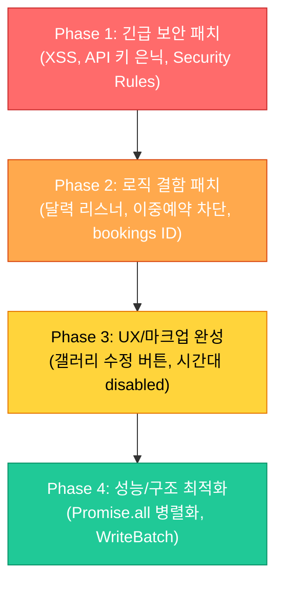

# 동네책방 아인 (AYIN) - 보안 취약점 패치 및 결함 보완 개발 인수인계서 (Handover)

본 문서는 동네책방 아인(AYIN) 웹 애플리케이션의 **종합 기술 진단 보고서(Audit Report)**에서 도출된 16건의 개선 과제 중, **치명적 보안 취약점 4건, 비즈니스 로직 결함 5건, UI/UX 결함 및 성능 최적화 방안**을 차기 개발자가 IDE에서 즉각 패치하고 검증할 수 있도록 단계별 코드 수정안과 검증 절차를 명시한 실전 개발 인수인계서입니다.

---

## 📋 목차
1. [패치 개요 및 대상 파일 매핑](#1-패치-개요-및-대상-파일-매핑)
2. [Phase 1: 긴급 보안 취약점 패치 (Critical)](#2-phase-1-긴급-보안-취약점-패치-critical)
   - 1.1 Stored XSS 방어 (이스케이프 헬퍼 도입)
   - 1.2 ImgBB API Key 평문 노출 제거 및 DB 은닉
   - 1.3 app.js 내 비인증 DB 초기화 코드 제거
   - 1.4 운영 디버그 콘솔 비활성화 및 Firestore Security Rules 강화
3. [Phase 2: 비즈니스 로직 및 달력 데이터 정합성 패치 (High)](#3-phase-2-비즈니스-로직-및-달력-데이터-정합성-패치-high)
   - 2.1 달력 컨트롤러 이벤트 리스너 중복 바인딩 분리
   - 2.2 빠른 대관 등록 모달 시간 중복 검증(`isTimeSlotOverlapping`) 추가
   - 2.3 달력 `bookings` 배열에 `rentalId` 부여 및 취소 정합성 확보
   - 2.4 로컬 타임존 날짜 파싱 헬퍼 함수 적용 (요일 밀림 방지)
   - 2.5 입력 폼 제약 조건 일치화 (20명/2시간) 및 마크업 문법 오류 수정
4. [Phase 3: UI/UX 결함 개선 및 운영 완성도 제고 (Medium)](#4-phase-3-uiux-결함-개선-및-운영-완성도-제고-medium)
   - 3.1 관리자 갤러리 목록 '수정' 버튼 추가 및 모달 연동
   - 3.2 대관 신청 시간 드롭다운 기예약 시간대 자동 `disabled` 처리
5. [Phase 4: 아키텍처 및 성능 최적화 (Optimization)](#5-phase-4-아키텍처-및-성능-최적화-optimization)
   - 4.1 Firestore 쿼리 직렬 병목 해소 (`Promise.all` 병렬화)
   - 4.2 도서 연쇄 삭제 시 `WriteBatch` 원자적 트랜잭션 적용
6. [통합 검증 체크리스트 (Verification Plan)](#6-통합-검증-체크리스트-verification-plan)

---

## 1. 패치 개요 및 대상 파일 매핑



### 작업 대상 파일 요약
* [admin.js](file:///c:/Users/jini4/.gemini/antigravity/scratch/local-bookstore/admin.js): XSS 이스케이프 적용, ImgBB 키 은닉 로드, 리스너 분리, 빠른 대관 중복 검증, `bookings` rentalId 부여, 갤러리 수정 버튼 바인딩, `Promise.all` 적용, `writeBatch` 적용
* [app.js](file:///c:/Users/jini4/.gemini/antigravity/scratch/local-bookstore/app.js): XSS 이스케이프 적용, `initializeDatabase()` 영구 삭제, 디버그 콘솔 제거, 타임존 계산 통일, 기예약 시간대 disabled 연동, `Promise.all` 적용
* [index.html](file:///c:/Users/jini4/.gemini/antigravity/scratch/local-bookstore/index.html): 중복 닫는 `</div>` 제거, 인원(`max="20"`) 및 시간(`min="2"`) 속성 일치화
* [admin.html](file:///c:/Users/jini4/.gemini/antigravity/scratch/local-bookstore/admin.html): 수동 예약 폼 인원(`max="20"`) 일치화

---

## 2. Phase 1: 긴급 보안 취약점 패치 (Critical)

### 2.1 Stored XSS 방어 (HTML 이스케이프 헬퍼 도입)
사용자 입력값(신청자 이름, 목적, 도서 제목, 리뷰 등)을 `innerHTML`로 DOM에 주입하기 전에 특수문자를 엔티티로 치환하는 `escapeHTML()` 헬퍼를 도입합니다.

#### [app.js](file:///c:/Users/jini4/.gemini/antigravity/scratch/local-bookstore/app.js) 및 [admin.js](file:///c:/Users/jini4/.gemini/antigravity/scratch/local-bookstore/admin.js) 최상단 추가
```javascript
// HTML 특수문자 이스케이프 유틸리티 (Stored XSS 방어)
function escapeHTML(str) {
  if (str === null || str === undefined) return '';
  return String(str)
    .replace(/&/g, '&amp;')
    .replace(/</g, '&lt;')
    .replace(/>/g, '&gt;')
    .replace(/"/g, '&quot;')
    .replace(/'/g, '&#039;');
}
```

#### [admin.js](file:///c:/Users/jini4/.gemini/antigravity/scratch/local-bookstore/admin.js) 테이블 렌더링 수정 예시
```javascript
// 대관 목록 렌더링 시 사용자 입력값 이스케이프 적용
tr.innerHTML = `
  <td>${escapeHTML(r.name)}</td>
  <td>${escapeHTML(r.phone)}</td>
  <td>${r.date} ${r.time} (${r.hours}시간)</td>
  <td>${escapeHTML(r.purpose)}</td>
  <td><strong>${(r.totalPrice || 0).toLocaleString()}원</strong></td>
  <td>...</td>
`;
```

---

### 2.2 ImgBB API Key 평문 노출 제거 및 DB 은닉
소스 코드에 직접 노출된 `cachedImgbbKey = "7472fcb4..."`를 빈 문자열로 초기화하고, 관리자 인증이 완료된 후에만 Firestore `config/keys` 문서에서 안전하게 읽어오도록 리팩토링합니다.

#### [admin.js](file:///c:/Users/jini4/.gemini/antigravity/scratch/local-bookstore/admin.js) 수정
```javascript
// AS-IS: 하드코딩
// let cachedImgbbKey = "7472fcb4ed213a7694ff36e0fec00153";

// TO-BE: 소스 코드에서 키 제거
let cachedImgbbKey = "";

// initDashboardData() 내부에서 Firestore config/keys 로드
try {
  const keysSnap = await getDoc(doc(db, "config", "keys"));
  if (keysSnap.exists()) {
    cachedImgbbKey = keysSnap.data().imgbbKey || "";
  }
} catch (keyErr) {
  console.warn("ImgBB key could not be loaded from Firestore:", keyErr);
}
```

---

### 2.3 app.js 내 비인증 DB 초기화 코드 제거
일반 고객용 스크립트인 `app.js`에서 Firestore 전체 문서를 덮어쓰는 `initializeDatabase()` 함수 선언부 및 호출부를 완전히 제거합니다. (DB 초기화는 관리자 전용인 `admin.js`에서만 수행)

#### [app.js](file:///c:/Users/jini4/.gemini/antigravity/scratch/local-bookstore/app.js) 수정
* L193~L225: `async function initializeDatabase()` 선언부 삭제
* L255: `await initializeDatabase();` 호출부 삭제 및 로컬 기본값(`fallback`) 로드로 대체

---

### 2.4 운영 디버그 콘솔 비활성화 및 Firestore Security Rules 배포

#### [app.js](file:///c:/Users/jini4/.gemini/antigravity/scratch/local-bookstore/app.js) 및 [admin.js](file:///c:/Users/jini4/.gemini/antigravity/scratch/local-bookstore/admin.js) 상단 디버그 오버레이 제거
* 상단 즉시실행함수 `(function() { const debugDiv = document.createElement('div'); ... })();` 블록 전체 삭제 (또는 `DEBUG_MODE = false` 플래그로 비활성화).

#### Firebase Console에 배포할 최종 보안 규칙 (Security Rules)
```javascript
rules_version = '2';
service cloud.firestore {
  match /databases/{database}/documents {
    // 1. 대관 신청: 일반 고객은 신규 등록(create)만 허용, 관리자만 읽기/수정/삭제
    match /rentals/{rentalId} {
      allow create: if true;
      allow read, update, delete: if request.auth != null;
    }
    
    // 2. 민감 정보 문서: 관리자만 읽기/쓰기 허용
    match /config/keys {
      allow read, write: if request.auth != null;
    }
    
    // 3. 일반 공개 콘텐츠 (메뉴, 도서, 달력, 갤러리): 누구나 읽기 허용, 수정은 관리자만 허용
    match /{document=**} {
      allow read: if true;
      allow write: if request.auth != null;
    }
  }
}
```

---

## 3. Phase 2: 비즈니스 로직 및 달력 데이터 정합성 패치 (High)

### 2.1 달력 컨트롤러 이벤트 리스너 중복 바인딩 분리
`initDashboardData()`가 재시도되거나 재실행될 때마다 `initAdminCalendarControls()` 안의 `addEventListener`가 누적되어 달력이 여러 달씩 점프하는 버그를 해결합니다.

#### [admin.js](file:///c:/Users/jini4/.gemini/antigravity/scratch/local-bookstore/admin.js) 수정
* `initAdminCalendarControls()` 내부의 이벤트 리스너 바인딩(`addEventListener`)을 `setupCalendarEventListeners()` 함수로 분리하여 **스크립트 기동 시 단 1회만 실행**하도록 수정합니다.
* `initAdminCalendarControls()`는 순수하게 `<select>` 옵션 렌더링 및 동기화만 담당합니다.

```javascript
let calendarListenersBound = false;

function setupCalendarEventListeners() {
  if (calendarListenersBound) return;
  
  const prevBtn = document.getElementById('admin-cal-prev');
  const nextBtn = document.getElementById('admin-cal-next');
  const todayBtn = document.getElementById('admin-cal-today');
  const yearSelect = document.getElementById('admin-cal-year-select');
  const monthSelect = document.getElementById('admin-cal-month-select');

  if (prevBtn) {
    prevBtn.addEventListener('click', () => {
      currentAdminMonth--;
      if (currentAdminMonth < 0) { currentAdminMonth = 11; currentAdminYear--; }
      syncSelectsAndRender();
    });
  }
  if (nextBtn) {
    nextBtn.addEventListener('click', () => {
      currentAdminMonth++;
      if (currentAdminMonth > 11) { currentAdminMonth = 0; currentAdminYear++; }
      syncSelectsAndRender();
    });
  }
  if (todayBtn) {
    todayBtn.addEventListener('click', () => {
      currentAdminYear = new Date().getFullYear();
      currentAdminMonth = new Date().getMonth();
      syncSelectsAndRender();
    });
  }
  if (yearSelect) {
    yearSelect.addEventListener('change', (e) => {
      currentAdminYear = parseInt(e.target.value);
      renderScheduleTab();
    });
  }
  if (monthSelect) {
    monthSelect.addEventListener('change', (e) => {
      currentAdminMonth = parseInt(e.target.value);
      renderScheduleTab();
    });
  }

  calendarListenersBound = true;
}

// 스크립트 초기 로드 시 1회 호출
setupCalendarEventListeners();
```

---

### 2.2 빠른 대관 등록 모달 시간 중복 검증(`isTimeSlotOverlapping`) 추가
탭 4 달력 날짜 클릭 모달의 `quickBookingForm`에 중복 검증이 누락되어 발생하던 이중 예약 결함을 해결합니다.

#### [admin.js](file:///c:/Users/jini4/.gemini/antigravity/scratch/local-bookstore/admin.js) 공통 검증 함수 정의 및 적용
```javascript
// 시간대 겹침 검증 공통 함수
function isTimeSlotOverlapping(date, startTimeStr, hours) {
  const startMin = parseTimeToMinutes(startTimeStr);
  const endMin = startMin + (hours * 60);

  // 1. calendarData 캐시의 bookings 검사
  const calSchedule = calendarData[date];
  if (calSchedule && calSchedule.bookings) {
    const overlapInCal = calSchedule.bookings.some(b => {
      const bStart = parseTimeToMinutes(b.time);
      const bEnd = bStart + (b.hours * 60);
      return (startMin < bEnd && bStart < endMin);
    });
    if (overlapInCal) return true;
  }

  // 2. rentalsData 캐시의 confirmed 예약 검사
  return rentalsData.some(r => {
    if (r.date === date && r.status === 'confirmed') {
      const rStart = parseTimeToMinutes(r.time);
      const rEnd = rStart + (r.hours * 60);
      return (startMin < rEnd && rStart < endMin);
    }
    return false;
  });
}
```

#### `quickBookingForm` submit 핸들러에 검증 추가
```javascript
quickBookingForm.addEventListener('submit', async (e) => {
  e.preventDefault();
  const time = document.getElementById('quick-book-time').value;
  const hours = parseInt(document.getElementById('quick-book-hours').value);

  // [신규 추가] 시간대 중복 검증
  if (isTimeSlotOverlapping(selectedAdminDateStr, time, hours)) {
    alert('죄송합니다. 해당 일자의 선택하신 시간대에 이미 확정된 대관 일정이 존재합니다.');
    return;
  }
  
  // 정상 등록 로직 진행...
});
```

---

### 2.3 달력 `bookings` 배열에 `rentalId` 부여 및 취소 정합성 확보
동일 시간대에 예약이 복수 개 존재할 때 1건만 취소해도 달력에서 모두 지워지던 문제를 `rentalId` 매핑으로 수정합니다.

#### [admin.js](file:///c:/Users/jini4/.gemini/antigravity/scratch/local-bookstore/admin.js) 동기화 함수 수정
```javascript
// 1. 대관 동기화 시 rentalId 함께 저장
async function syncBookingToCalendar(rentalId, date, time, hours) {
  const calRef = doc(db, "calendar", date);
  const calSnap = await getDoc(calRef);
  let bookings = [];

  if (calSnap.exists()) {
    const calData = calSnap.data();
    bookings = calData.bookings || [];
  }

  // rentalId 기준으로 중복 방지
  if (!bookings.some(b => b.rentalId === rentalId)) {
    bookings.push({ rentalId, time, hours });
  }

  calendarData[date] = { status: 'event', label: '대관', bookings };
  await setDoc(calRef, { status: 'event', label: '대관', bookings });
  renderScheduleTab();
}

// 2. 취소 시 rentalId 기준으로 정확히 1건만 필터링
async function syncBookingCancellationToCalendar(rentalId, date) {
  const calRef = doc(db, "calendar", date);
  const calSnap = await getDoc(calRef);

  if (calSnap.exists()) {
    const calData = calSnap.data();
    let bookings = calData.bookings || [];
    
    // rentalId가 일치하는 항목만 제거
    bookings = bookings.filter(b => b.rentalId !== rentalId);

    if (bookings.length > 0) {
      calendarData[date] = { status: 'event', label: '대관', bookings };
      await setDoc(calRef, { status: 'event', label: '대관', bookings });
    } else {
      delete calendarData[date];
      const dayOfWeek = parseLocalDate(date).getDay();
      if (dayOfWeek === 0 || dayOfWeek === 6) {
        calendarData[date] = { status: 'holiday', label: '휴' };
        await setDoc(calRef, { status: 'holiday', label: '휴' });
      } else {
        await deleteDoc(calRef);
      }
    }
    renderScheduleTab();
  }
}
```

---

### 2.4 로컬 타임존 날짜 파싱 헬퍼 함수 적용
`new Date("2026-07-04")`의 UTC 자정 파싱에 따른 요일 왜곡을 방지하기 위해 로컬 날짜 객체 생성 헬퍼를 적용합니다.

```javascript
// 로컬 타임존 안전 날짜 파싱 헬퍼
function parseLocalDate(dateStr) {
  const [year, month, day] = dateStr.split('-').map(Number);
  return new Date(year, month - 1, day);
}

// 사용 예시
const dayOfWeek = parseLocalDate(dateString).getDay();
```

---

### 2.5 입력 폼 제약 조건 일치화 및 HTML 문법 오류 수정

#### 1) [index.html](file:///c:/Users/jini4/.gemini/antigravity/scratch/local-bookstore/index.html) 제약 조건 수정 (L373, L377)
* 이용 시간: `min="1"` ➡️ `min="2"` (안내문 "최소 2시간부터 대여 가능"과 일치)
* 예상 인원: `max="12"` ➡️ `max="20"` (안내문 "최대 수용 인원: 20명"과 일치)

```html
<input type="number" id="rental-hours" name="hours" min="2" max="8" value="2" required>
<input type="number" id="rental-people" name="people" min="1" max="20" placeholder="명" required>
```

#### 2) [index.html](file:///c:/Users/jini4/.gemini/antigravity/scratch/local-bookstore/index.html) 중복 닫는 태그 제거 (L165~L166)
* L165~L166 부근에 연속으로 위치한 닫는 `</div>` 중복 태그 1개를 삭제합니다.

---

## 4. Phase 3: UI/UX 결함 개선 및 운영 완성도 제고 (Medium)

### 3.1 관리자 갤러리 목록 '수정' 버튼 추가 및 모달 연동
`admin.js`의 `renderGalleryTab()` 테이블 렌더링에 `[수정]` 버튼을 추가하여, 등록된 행사 게시글의 오타나 날짜를 삭제 없이 즉시 수정할 수 있도록 연동합니다.

#### [admin.js](file:///c:/Users/jini4/.gemini/antigravity/scratch/local-bookstore/admin.js) `renderGalleryTab()` 수정
```javascript
function renderGalleryTab() {
  if (!galleryTableBody) return;
  galleryTableBody.innerHTML = '';

  if (galleryData.length === 0) {
    galleryTableBody.innerHTML = '<tr><td colspan="4" style="text-align: center; color: var(--text-muted); padding: 20px;">등록된 행사 사진이 없습니다.</td></tr>';
    return;
  }

  galleryData.forEach(item => {
    const tr = document.createElement('tr');
    const thumb = item.imageUrls && item.imageUrls.length > 0 ? item.imageUrls[0] : '';
    
    tr.innerHTML = `
      <td></td>
      <td style="font-weight: 700; color: var(--color-primary);">${escapeHTML(item.title)}</td>
      <td>${item.date}</td>
      <td>
        <button class="btn-action btn-edit-gallery" data-id="${item.id}" style="margin-right: 4px;">수정</button>
        <button class="btn-action btn-delete btn-delete-gallery" data-id="${item.id}">삭제</button>
      </td>
    `;
    galleryTableBody.appendChild(tr);
  });

  // 수정 버튼 이벤트 바인딩
  galleryTableBody.querySelectorAll('.btn-edit-gallery').forEach(btn => {
    btn.addEventListener('click', () => {
      const id = btn.getAttribute('data-id');
      const item = galleryData.find(g => g.id === id);
      if (item) {
        document.getElementById('edit-gallery-id').value = item.id;
        document.getElementById('gallery-title').value = item.title;
        document.getElementById('gallery-date').value = item.date;
        document.getElementById('gallery-desc').value = item.description;
        document.getElementById('gallery-editor-title').textContent = "행사 갤러리 수정";
        document.getElementById('btn-submit-gallery').textContent = "수정 완료";
        document.getElementById('gallery-images').required = false; // 수정 시 이미지 첨부 선택사항
        openGalleryUploadModal();
      }
    });
  });

  // 삭제 버튼 이벤트 바인딩...
}
```

---

### 3.2 대관 신청 시간 드롭다운 기예약 시간대 자동 `disabled` 처리
사용자가 대여 날짜를 선택했을 때, 해당 일자에 이미 확정된 시간대의 `<option>` 태그에 `disabled` 및 `(예약 마감)` 표시를 붙여 사용자 제출 실패 피로도를 원천 차단합니다.

#### [app.js](file:///c:/Users/jini4/.gemini/antigravity/scratch/local-bookstore/app.js) 수정
```javascript
const rentalDateInput = document.getElementById('rental-date');
const rentalTimeSelect = document.getElementById('rental-time');

if (rentalDateInput && rentalTimeSelect) {
  rentalDateInput.addEventListener('change', (e) => {
    const selectedDate = e.target.value;
    if (!selectedDate) return;

    const calDoc = calendarData[selectedDate];
    const bookedSlots = (calDoc && calDoc.bookings) ? calDoc.bookings : [];

    // 시간 옵션 순회 검사
    Array.from(rentalTimeSelect.options).forEach(opt => {
      if (!opt.value) return; // '시간 선택' 기본 옵션 제외
      
      const optMinutes = parseTimeToMinutes(opt.value);
      // 기본 2시간 기준으로 겹치는지 체크
      const isBooked = bookedSlots.some(b => {
        const bStart = parseTimeToMinutes(b.time);
        const bEnd = bStart + (b.hours * 60);
        return (optMinutes < bEnd && bStart < (optMinutes + 120));
      });

      if (isBooked) {
        opt.disabled = true;
        opt.textContent = `${opt.value} (대관 마감)`;
      } else {
        opt.disabled = false;
        opt.textContent = `${opt.value}`;
      }
    });
  });
}
```

---

## 5. Phase 4: 아키텍처 및 성능 최적화 (Optimization)

### 4.1 Firestore 쿼리 직렬 병목 해소 (`Promise.all` 병렬화)
현재 5개 컬렉션을 `await`로 하나씩 순차 대기하여 발생하는 초기 로딩 지연(750ms+)을 `Promise.all()` 병렬 요청으로 개선하여 **단일 쿼리 시간(~150ms) 내에 로딩을 완료**하도록 전환합니다.

#### [admin.js](file:///c:/Users/jini4/.gemini/antigravity/scratch/local-bookstore/admin.js) 및 [app.js](file:///c:/Users/jini4/.gemini/antigravity/scratch/local-bookstore/app.js) 수정
```javascript
// AS-IS: 직렬 호출 (느림)
// const menuSnap = await getDoc(...);
// const keepersSnap = await getDocs(...);
// const booksSnap = await getDocs(...);
// ...

// TO-BE: Promise.all 병렬 호출 (빠름)
const [menuSnap, keepersSnap, booksSnap, calendarSnap, gallerySnap] = await Promise.all([
  getDoc(doc(db, "config", "menu")),
  getDocs(collection(db, "keepers")),
  getDocs(collection(db, "books")),
  getDocs(collection(db, "calendar")),
  getDocs(collection(db, "gallery"))
]);
```

---

### 4.2 도서 연쇄 삭제 시 `WriteBatch` 원자적 트랜잭션 적용
책방지기 삭제 시 for 루프 안에서 개별 `deleteDoc`을 호출하던 방식을 `writeBatch`로 일괄 묶어, 네트워크 장애 시에도 데이터 불일치(지기는 지워지고 도서는 남는 현상)를 원천 방지합니다.

#### [admin.js](file:///c:/Users/jini4/.gemini/antigravity/scratch/local-bookstore/admin.js) `deleteKeeper()` 수정
```javascript
import { writeBatch } from "https://www.gstatic.com/firebasejs/10.12.0/firebase-firestore.js";

async function deleteKeeper(id) {
  if (confirm('해당 책방지기를 삭제하시겠습니까? 관련 추천 도서도 모두 함께 삭제됩니다.')) {
    showLoader('책방지기 및 도서 연쇄 삭제 중...');
    try {
      const batch = writeBatch(db);

      // 1. 지기 문서 삭제 등록
      batch.delete(doc(db, "keepers", id));

      // 2. 연관 도서 문서들 일괄 삭제 등록
      const booksQuery = query(collection(db, "books"), where("keeperId", "==", id));
      const querySnapshot = await getDocs(booksQuery);
      querySnapshot.forEach(docSnap => {
        batch.delete(doc(db, "books", docSnap.id));
      });

      // 3. 원자적(Atomic) 일괄 커밋
      await batch.commit();

      // 로컬 캐시 동기화
      keepersData.keepers = keepersData.keepers.filter(k => k.id !== id);
      keepersData.books = keepersData.books.filter(b => b.keeperId !== id);

      hideLoader();
      renderCurationTab();
      alert('책방지기와 추천 도서가 안전하게 일괄 삭제되었습니다.');
    } catch (err) {
      console.error("Cascade delete error:", err);
      hideLoader();
      alert('삭제 중 오류가 발생했습니다.');
    }
  }
}
```

---

## 6. 통합 검증 체크리스트 (Verification Plan)

| 번호 | 검증 항목 | 수행 절차 | 기대 결과 (Pass 기준) |
| :---: | :--- | :--- | :--- |
| **V-01** | Stored XSS 방어 검증 | 대관 신청 폼의 신청자명에 `` 입력 후 제출 | 관리자 대시보드 대관 테이블에서 스크립트 실행 없이 텍스트 그대로 안전 출력 |
| **V-02** | ImgBB 키 은닉 검증 | 브라우저 소스 보기에서 `admin.js` 내 API Key 문자열 검색 | 소스 코드에 키가 전혀 노출되지 않고 Firestore에서 정상 수신 |
| **V-03** | 빠른 대관 중복 방지 | 탭 4 달력 미니 모달에서 이미 확정된 시간대(예: 14:00~16:00)로 현장 대관 등록 시도 | 중복 안내 경고창이 뜨며 등록이 즉시 차단됨 |
| **V-04** | 달력 리스너 누적 방지 | 관리자 화면에서 재로그인 또는 네트워크 재시도 후 달력 `<` 및 `>` 클릭 | 정확히 1개월씩만 매끄럽게 전환됨 |
| **V-05** | 예약 동시 삭제 버그 검증 | 동일 일자/시간에 예약 2건 생성 후 1건 취소 | 나머지 1건의 예약은 달력에 정상 유지됨 |
| **V-06** | 대여 인원/시간 제약 검증 | 메인 신청 폼에서 인원 15~20명, 시간 2시간 입력 후 제출 | 폼 제약 에러 없이 정상적으로 접수 완료 |
| **V-07** | 갤러리 수정 기능 검증 | 관리자 갤러리 탭 테이블에서 [수정] 버튼 클릭 후 내용 수정 저장 | 새 글 등록이 아닌 기존 글의 내용이 안전하게 갱신됨 |
| **V-08** | 기예약 시간대 비활성화 | 이미 예약된 날짜를 대관 신청서에서 선택 | 해당 시간대 `<option>`이 비활성화(`disabled`)되어 선택 불가 |
